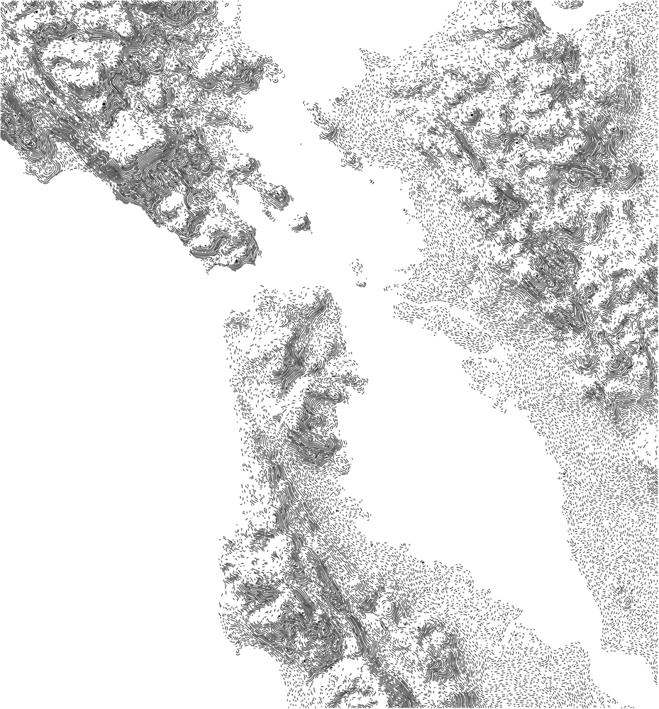
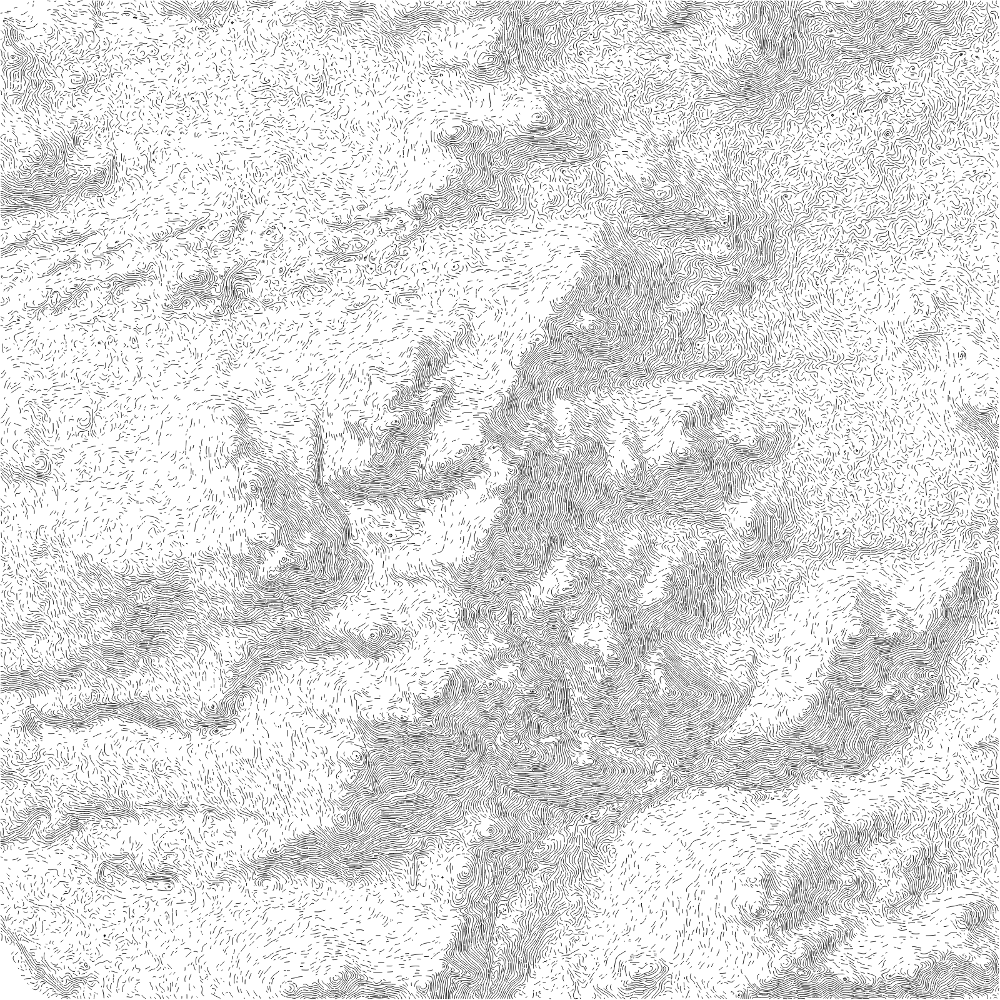
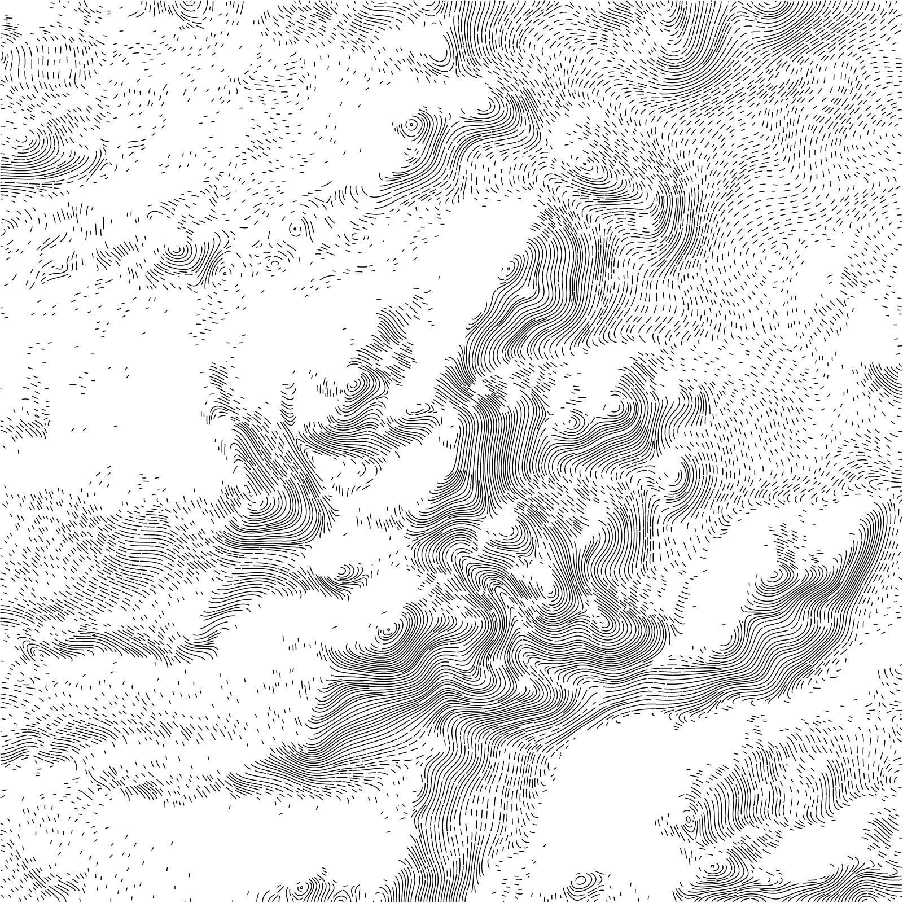
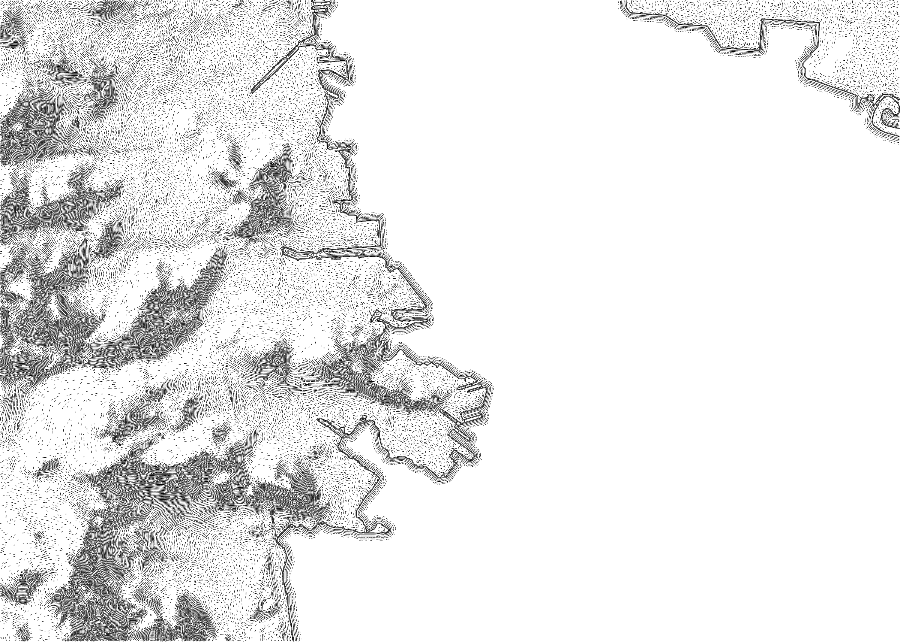

# burin-map

Pen-and-ink terrain maps from real elevation data: thousands of short black
strokes that follow the lie of the land, dense and solid on shadowed slopes,
sparse stipple on flat ground, a few scattered marks on lit slopes. Up close
it is line drawing; from afar it reads as hillshading.

**burin-map** is the project: Rust engine, CLI, Python and Node APIs, and the
interactive site **BurinMap** at [burin-map.vercel.app](https://burin-map.vercel.app)
(password `folder`) — same engine in the browser, not a different product.

```bash
cargo install burin-map
pip install burin-map          # or: conda install -c conda-forge burin-map
npm install -g burin-map       # or: npx burin-map …
```

*A burin is the steel tool maps were engraved with on copper plates for
centuries.*

<p align="center">
  
  <br />
  <em>Bay Area</em>
</p>

Same place, same extent (Twin Peaks, 8 km), two styles:

<p align="center">
  
  &nbsp;
  
</p>

| | Freehand | Mechanical |
| --- | --- | --- |
| `space` | 6.5 | 10 |
| `mod_smooth` | 2.5 | 20 |
| `mod_wobble` | 55 | 0 |
| `mod_jitter` | 0.75 | 0 |
| `mod_breaks` | 0.4 | 0 |
| `input_gain` | 5 | 2.8 |
| `input_light_floor` | 0.18 | 0 |
| `input_flat` | 0.4 | 0.12 |
| `batch_stroke` | 0.95 | 1.5 |

## Rust

```bash
cargo install burin-map
# library: cargo add burin-map   /   cargo add burin-map-core
```

Until crates.io has it, from this repo (needs a [Rust toolchain](https://rustup.rs)):

```bash
cargo install --path crates/burin-map      # → ~/.cargo/bin/burin-map
```

```bash
burin-map --terrain-place san-francisco --out-file bay.png --out-format both
burin-map --terrain-at "Twin Peaks, San Francisco" --terrain-size 14km --out-file tp.png
burin-map --tat "37.8716,-122.2727" --ts 12km 8km --of berkeley.png
burin-map --terrain-bounds -122.75 37.45 -122.05 38.05 --out-file bay.png
burin-map --help
```

The image is 2400 px wide unless you give a paper size in mm with `--frame-size` (see
[Plotter and print](#plotter-and-print)).

As a library:

```rust
let (lat, lon, _) = burin_map::locate("Twin Peaks, San Francisco")?;
let area = burin_map::bounds_around(lat, lon, 14.0, 14.0);
let map = burin_map::draw(&area, &burin_map::Style::default(), &burin_map::Frame::default(), |m| println!("{m}"))?;
std::fs::write("tp.svg", map.to_svg())?;
```

## Python

Same project. The package name is `burin-map`; the module you import is
`burin_map`. Python ≥ 3.10; numpy is the only runtime dependency of the
wrapper.

```bash
pip install burin-map
# or:  conda install -c conda-forge burin-map
```

That installs `import burin_map` and the `burin-map` command. Prebuilt wheels
cover the usual platforms; from source you need a
[Rust toolchain](https://rustup.rs).

Until the package is on PyPI / conda-forge, install from this repo:

```bash
pip install "git+https://github.com/piLeoni/burin-map.git"
# or from a local clone:  pip install .    # editable: pip install -e ".[dev]"
```

```python
import burin_map

lat, lon, name = burin_map.locate("Twin Peaks, San Francisco")   # or "37.75,-122.45"
area = burin_map.bounds_around(lat, lon, 14, 14)                 # km

d = burin_map.draw(area)                     # 2400 px wide; frame_size_mm=... for paper
d.save_png("tp.png")
d.save_svg("tp.svg")
d.paths                                  # dashes: list of N×2 numpy arrays, px

# Tweak the style (print(burin_map.style_help()) lists every parameter)
d = burin_map.draw(area, burin_map.Style(input_gain=4, mod_wobble=30))

# Frame in mm (plotter / print): scale follows from frame and pen
d = burin_map.draw(area, frame_size_mm=(297, 420), frame_pen_mm=0.3, log=print)

# Any elevation grid you already have (metres, square pixels, row 0 = north)
d = burin_map.draw_elevation(elev, px_m=30.0)
```

Elevation is downloaded on demand (see [Data](#data)); addresses are looked
up with OpenStreetMap's [Nominatim](https://nominatim.org/) (one request
per run, no key).

## Node

Same engine as a native Node addon ([napi-rs](https://napi.rs/)): usable from
code and as `npx burin-map` / the `burin-map` command. Node ≥ 18.

```bash
npm install burin-map
# or:  npm install -g burin-map
# or:  npx burin-map --terrain-at "Twin Peaks, San Francisco" --terrain-size 8km --out-file tp.png
```

That installs `import` / `require("burin-map")` and the `burin-map` command.
Prebuilt binaries cover the usual platforms; from source you need a
[Rust toolchain](https://rustup.rs).

```js
import { locate, boundsAround, draw, drawElevation } from "burin-map";
import { writeFileSync } from "node:fs";

const [lat, lon] = locate("Twin Peaks, San Francisco");
const [west, south, east, north] = boundsAround(lat, lon, 14, 14);

const d = draw(west, south, east, north, { input_gain: 4, mod_wobble: 30 });
writeFileSync("tp.png", d.png());
writeFileSync("tp.svg", d.svg());

// Or any elevation grid you already have (metres, row 0 = north):
// const d = drawElevation(elevFloat32Array, width, height, pxM, { space: 6 });
```

## How it works

1. **Elevation.** Terrarium terrain tiles are read and reprojected to a transverse
   Mercator centred on the area, so pixels are square in metres, slopes are
   true and scale is exact at the centre.
2. **Direction.** The terrain is heavily smoothed and its gradient turned by
   90°: a field of unit vectors running along the contour lines. Lines that
   follow it wrap concentrically around peaks, like contours, but with broad
   even curves instead of bunching up on steep ground.
3. **Lines.** Streamlines are traced through that field at an even distance
   from each other (Jobard & Lefer, 1997), a little tighter on steep ground
   and in shadow. Gaps too narrow for a new line at full space but still
   wide get one in the middle, so lines don't bunch into bands.
4. **Input.** Lambert shading at two scales: detail (ridges, valleys) and
   whole massifs, so an entire mountain side reads as one shadow from afar.
   Flat ground sits at a fixed value (`input_flat`), shadow raises it towards 1, light
   lowers it towards 0.
5. **Dashes.** Every line is broken into dashes whose length follows the
   input: solid in shadow, stipple on the flat. On lit slopes dashes are
   dropped at random rather than shortened, so a few strokes still hint at
   the form.
6. **Hand.** Dash length and pitch are randomised, on flat ground the line
   direction wanders slightly, and solid lines in shadow get an occasional
   small break, so nothing reads as machine-made.

Every length in the style is in output pixels, so the look stays the same at
any scale: a whole region or a single city.

## Plotter and print

```bash
burin-map --terrain-place san-francisco --frame-size 267 390 --pen-width 0.3 \
  --out-file bay.png --out-format both
```

The pen takes the place of the stroke width: every proportion of the style
is kept, and resolution, line pitch and map scale follow from frame and pen.
The drawing fits inside the frame, the SVG has its size in millimetres and
no background, and lines are ordered to keep pen-up travel short. The log
reports frame size, line pitch, scale and pen-up travel.

Terrain size, frame size and scale are tied: give any two and the third
follows.

```bash
# terrain + frame → scale (the area takes the frame's proportions)
burin-map --terrain-at "Mont Blanc" --terrain-size 40km --frame-size 267 390 --out-format svg
# frame + scale → terrain: 297 mm at 1:50,000 is 14.85 km
burin-map --tat Zermatt --fs 297 420 --esc 1:50000 --fmt svg
# terrain + scale → frame
burin-map --terrain-place bern --export-scale 1:100000 --out-format svg
```

Giving all three is an error, since they can't all hold at once.

Lines are always 4 pen widths apart, so a finer pen means more lines and
more detail on the same sheet, and a longer plot:

| pen | line pitch | A3 bay, lines | scale |
|---|---|---|---|
| 0.3 mm | 1.2 mm | ~3,500 | 1:232,000 |
| 0.1 mm | 0.4 mm | ~26,000 | 1:232,000 |

## Style parameters

Grammar is grouped by what it controls. Long names are descriptive; short
aliases work on the CLI (e.g. `--sl` for `--space-light`).

| group | idea |
|---|---|
| `space_*` | distance between lines — `space_light` / `space_dark` set the range |
| `dash_*` | ink along each line — `dash_light` / `dash_dark` set the range |
| `mod_*` | hand-drawn character (jitter, breaks, wobble, smooth) |
| `input_*` | 0…1 field from terrain + sun (feeds space and dash) |
| `sun_*` | light direction |
| `engine_*` | streamline tracer (usually leave alone) |
| `batch_*` | per-pass floor, stroke, seed |

The ones worth touching first:

| parameter | default | effect |
|---|---|---|
| `space` | 4.8 | base distance between lines, px |
| `space_light` | 1.0 | space multiplier in full light (>1 = more open) |
| `space_dark` | 0.7 | space multiplier in full dark (<1 = denser) |
| `space_steep` | 0.4 | how much steep ground tightens space (`0` = off, `1` = max) |
| `dash_light` | 0.15 | ink fraction in full light |
| `dash_dark` | 1.0 | ink fraction in full dark |
| `dash_drop` | 1.0 | drop random dashes on flat/light (`0` = off) |
| `dash_period` | 2.2 | dash+gap length, × `space` |
| `mod_jitter` | 0.45 | dash irregularity; 0 looks machine-made |
| `mod_breaks` | 0.15 | breaks in otherwise solid runs |
| `mod_smooth` | 6 | smoothness of the line curves |
| `input_gain` | 3.0 | contrast of the relief |
| `batch_stroke` | 1.2 | stroke width, px |
| `batch_seed` | 1 | different drawing of the same place |

Flat ranges mean a flat channel: `--space-light 1 --space-dark 1` keeps
uniform space; `--dash-light 1 --dash-dark 1 --dash-drop 0` draws continuous
lines.

Every flag has a short form made of its initials (`--space-light` → `--sl`,
`--dash-drop` → `--ddrop`, `--terrain-at` → `--tat`, `--frame-size` → `--fs`,
`--out-format` → `--fmt`). `burin-map --help` (or
`print(burin_map.style_help())` in Python) lists all of them. They are declared once in `crates/burin-map-core/src/style.rs`.

### Multiple batch passes

By default there is one pass at angle 0° (lines along the contours). Each
`--batch` starts another parallel pass; style flags after it apply only to
that pass until the next `--batch` (`-b`). `--batch-angle` (`--ba`) is degrees
from the contour tangent (0 = along, 90 = downslope).

The terrain parameters (`input_*`, `sun_*`, `space_light`, `space_dark`,
`space_steep*`, `mod_wobble*`, `mod_smooth`) carry over: a pass that leaves one
out takes it from the pass before, so one sun set in the first pass lights
them all, and a later pass can still set its own. Other parameters fall back
to their defaults. The same holds for `batches` in a document.

```bash
# simple — one pass, all defaults
burin-map --terrain-place bern

# still one pass, with style (short forms)
burin-map --tp bern --s 5 --dl 0.3

# along + broken cross-hatch in shadow
burin-map --terrain-at "Twin Peaks, San Francisco" --terrain-size 8km --out-file tp.png \
  --batch --space 6 --mod-breaks 0.12 \
  --batch --batch-angle 90 --mod-breaks 0.85 --batch-floor 0.45

# three angles, short forms
burin-map --tp bern \
  -b --s 6 \
  -b --ba 90 --mb 0.8 --bf 0.4 \
  -b --ba 45 --mb 0.7 --bf 0.5
```

### Water

Sea, lakes and rivers come from OpenStreetMap, through
[terramask](https://github.com/piLeoni/terramask) and the
[OpenFreeMap](https://openfreemap.org) vector tiles. When a document has a
`water` block, that mask, not the elevation, decides what is land, so polders
below sea level and lakes above it come out right. The shoreline is stroked,
and each water batch fills the water with its own lines:

```yaml
batches:                 # the land, as before (`land: { batches: … }` is the long form)
  - angle: 0
water:
  classes: [ocean, lake] # default: ocean, lake, river, dock
  shoreline: true        # stroke the shoreline
  batches:
    - follow: shore      # lines along the coast, fading out to sea
      style: { space: 4, water_reach: 60 }
    - follow: map        # hatching in one direction: degrees clockwise from north
      angle: 70
```

Water batches take the same style parameters as land ones, minus those that
need terrain (`sun_*`, most of `input_*`, `space_steep*`, `batch_floor`), plus
three of their own: `water_start` (gap to the first line), `water_reach` (how
far out the lines go, in px) and `water_fade`. There is no seabed: on water the
tone that shading gives on land is the distance from the shore, so `*_dark`
applies near the coast and `*_light` further out. On the
command line the block is one JSON argument: `--water '{"batches":[{"follow":"shore"}]}'`.

A water batch can also cover the open sea with something other than lines:
`draw: ripples` (broken rows of hand-drawn waves, as in Olaus Magnus' Carta
Marina) or `dots` (stippling, closer near the coast, as on Ortelius' maps).
`water_patches` gathers either in patches (0 evenly, 1 a few patches).
See [SYNTAX.md](SYNTAX.md#ripples-and-dots).

Any line can wave as if drawn by hand: `mod_wave` px to either side, about
once every `mod_wave_size` px, on land, water or the shoreline. With
`mod_wave_zone: 1` neighbouring lines wave together and keep an even spacing.
[`examples/ocean-currents.json5`](examples/ocean-currents.json5) uses it for
dense, swirling currents over the sea. See
[SYNTAX.md](SYNTAX.md#hand-drawn-waves).

The shoreline takes the land's modifiers too. Instead of `true`, give it
`lines` and a `style`:

```yaml
water:
  shoreline:
    lines: 2             # the shore, then one more `space` px out to sea
    style:
      space: 5
      dash_dark: 0.7     # dashed: ink at the shore, as on dark ground
      dash_light: 0.35   # further lines fade towards this, over water_reach
      mod_wobble: 25     # wanders as if drawn by hand
      mod_smooth: 2      # rounds off the pixel steps
      batch_stroke: 2    # its own line width
```

[`examples/bay-contours.json5`](examples/bay-contours.json5) puts it together:
contour lines with strong light and shade, a tight double shoreline and close
lines just off the coast.

<p align="center">
  
</p>

Every batch's `batch_stroke` is its own width: the SVG groups paths by width
(one `<g stroke-width>` per pen, each plotted on its own), and the PNG strokes
each group at its width.

## Data

Elevation is the Terrarium tiles of the
[AWS Terrain Tiles](https://registry.opendata.aws/terrain-tiles/) open
dataset, land heights and the sea floor alike, read through
[terramask](https://github.com/piLeoni/terramask) and cached by it (override
with `TERRAMASK_CACHE`). The command line and the browser use the same tiles.
The zoom follows the output resolution, up to 15; where the deeper zooms
flatten the sea to 0 m, the sea floor comes from zoom 10. The tiles combine
SRTM, national surveys and bathymetry; see the dataset's
[attribution](https://github.com/tilezen/joerd/blob/master/docs/attribution.md).

Limits worth knowing:

- Beyond 85° north or south there are no tiles.
- Much of the land is SRTM underneath (≈30 m): areas narrower than ~10–15 km
  start to show the data's grain, and cities and forests can show relief that
  isn't ground.
- The sea floor is a patchwork: detailed surveys near some coasts, coarse
  grids offshore, and `ground: sea` batches show the seams.
- Without a `water` block, sea is anything at or below 0.5 m, so land below
  sea level is left blank. With one, OpenStreetMap decides (see Water above).

## Architecture

Everything that turns elevation into strokes lives in **`burin-map-core`**: a
dependency-free Rust crate (fields, streamlines, dashes, style parameters).
That crate is the single source of truth. Thin shells sit around it:

| Shell | Crate / folder | Role |
| --- | --- | --- |
| CLI + I/O | `crates/burin-map` | terrain and water through terramask, transverse Mercator, geocoding, PNG/SVG, `burin-map` command |
| Python | `crates/burin-map-py` + `python/burin_map` | PyO3 bindings; the importable `burin_map` package |
| Node | `crates/burin-map-node` + `node/` | napi-rs bindings; `require` / `import` and `npx burin-map` |
| Web | `crates/burin-map-wasm` + `web/` | WASM bindings; React + Mapbox demo that draws the current view |

```text
  elevation / place
         │
         ▼
   ┌─────────────────┐     style params (style.rs)
   │  burin-map-core │◄──────────────────────────
   └────────┬────────┘
            │ Drawing { paths, svg, … }
      ┌─────┼──────────┬──────────┐
      ▼     ▼          ▼          ▼
     CLI  Python      Node      WASM → browser map
```

The browser map does not reimplement the look: it stitches Terrarium DEM
tiles for the viewport, calls the same WASM-built engine, and overlays the
SVG. Local style and camera are remembered in the browser; a light password
gate keeps casual traffic out of the public demo.

## Code layout

One repository, one engine, several front ends:

```text
crates/burin-map-core/  the drawing engine: pure computation, no I/O
  style.rs              every parameter, with its description
  fields.rs             direction field, input, space
  streamlines.rs        evenly spaced line placement
  dashes.rs             lines → dashes following the input
  order.rs              plotting order
  grid.rs, rng.rs       blur, gradient, percentiles; deterministic RNG
crates/burin-map/       Rust library + `burin-map` command
  dem.rs                terrain tiles (terramask), reprojection
  tmerc.rs              transverse Mercator
  geo.rs                addresses, coordinates, lengths, scales
  raster.rs             PNG
  cli.rs                command line (also run by the Python package)
crates/burin-map-py/    Python bindings (PyO3), built by maturin
crates/burin-map-node/  Node bindings (napi-rs), built from `node/`
crates/burin-map-wasm/  WebAssembly bindings (wasm-bindgen)
python/burin_map/       the Python package: a thin layer over the bindings
python/tests/           Python API tests
node/                   npm package: loader, `cli.js` for `npx`, native `.node`
web/                    React + DaisyUI (wireframe) + Mapbox + WASM overlay
  src/                  UI and terrarium → DEM stitching
  public/pkg/           wasm-pack output (served statically)
  public/pkg-mt/        the same, multi-threaded (needs cross-origin isolation)
  build-wasm.sh         build both WASM packages
  serve.sh              build WASM + `npm run dev` (Vite proxies elevation tiles)
examples/               PNG gallery for the README, and example documents
```

Each module opens with a comment explaining its step. The engine has no
dependencies at all, so the same code builds for the browser.

## WebAssembly

The same drawing engine runs in the browser via `burin-map-wasm`.
`web/build-wasm.sh` builds it with [wasm-pack](https://rustwasm.github.io/wasm-pack/)
into two packages, served from `web/public/`:

- `pkg/`: single-threaded, stable Rust. Works on any page.
- `pkg-mt/`: multi-threaded with [wasm-bindgen-rayon](https://github.com/RReverser/wasm-bindgen-rayon).
  Batches and the terrain fields use every core (about 1.4× faster for one
  batch, 1.65× for two, in Chrome on a 10-core Mac; the drawing is identical).
  It needs `SharedArrayBuffer`, so the page must be cross-origin isolated
  (`Cross-Origin-Opener-Policy: same-origin` and
  `Cross-Origin-Embedder-Policy: require-corp`), and a pinned nightly
  toolchain to rebuild the standard library with atomics. Without it the
  script builds only `pkg/`:

  ```bash
  rustup toolchain install nightly-2026-04-14 --profile minimal \
    --component rust-src --target wasm32-unknown-unknown
  ```

From a page (or the demo in `web/`):

```js
import init, { draw, style_params } from "./pkg/burin_map_wasm.js";
await init();

// elev: Float32Array of height in metres, row 0 = north
const result = draw(elev, width, height, pxM /* metres per pixel */, {
  space: 4.8,
  mod_wobble: 20,
});
result.paths;   // packed Float32Array for canvas stroking
result.svg;     // SVG document string
```

With `pkg-mt/`, run it in a Web Worker and call
`await initThreadPool(navigator.hardwareConcurrency)` once after `init()`.

You still need elevation yourself (the web demo stitches Terrarium DEM tiles
for the map viewport). Style knobs match the CLI / Python API; call
`style_params()` for the full list.

## Web map (BurinMap)

Live demo: **[burin-map.vercel.app](https://burin-map.vercel.app)** (password
`folder`). It is a PWA you can add to a phone home screen.

React + DaisyUI (wireframe) + Mapbox + the WASM module above. Explore the
basemap freely; when you stop, elevation tiles for that view are fetched,
drawn in WASM, and shown as an overlay. Moving again clears the overlay so
you can navigate, then redraws when you settle. On mobile the map is
full-screen; **Controls** opens the style panel.

```bash
cd web && npm install
cp .env.example .env.local
# edit .env.local: VITE_MAPBOX_TOKEN=pk.…  (from https://account.mapbox.com/access-tokens/)
./serve.sh                   # builds WASM, then `npm run dev`
# → http://127.0.0.1:8765
```

Or, with WASM already in `web/public/pkg`:

```bash
cd web && npm run dev
```

Vite proxies `/terrarium/…` to AWS (S3 has no CORS on GET). The Vercel
deploy uses a rewrite for the same path (`web/vercel.json`).

Drawing runs in a Web Worker (`src/lib/burin.worker.js`), so the map stays
responsive. Both the dev server and the Vercel deploy send the cross-origin
isolation headers, so the worker uses the threaded engine and the status line
shows the thread count. Without isolation, or if `pkg-mt/` fails to load, it
falls back to the single-threaded one.

### Documents and share links

A *document* describes a whole drawing: where (`area`) and how (`batches`).
The CLI reads it as JSON5 — plain JSON works too, and so do comments, trailing
commas and unquoted keys — with `--style-json` / `--style-file`, so a file
from the web app can be fed straight to the command line, and vice versa.

```json5
// Twin Peaks, two passes
{
  "area": { "at": "Twin Peaks, San Francisco", "size_km": [8, 8] },
  "batches": [
    { "angle": 0,  "style": { "space": 7, "mod_breaks": 0.1 } },
    { "angle": 90, "style": { "space": 7, "mod_breaks": 0.85, "batch_floor": 0.45 } },  // steep ground
  ],
}
```

Every `area` field maps to a CLI flag (`at`↔`--terrain-at`, `size_km`↔
`--terrain-size`, `size_mm`↔`--frame-size`, `scale`↔`--export-scale`,
`pen_mm`↔`--pen-width`, …). Explicit command-line flags always win; the
document fills in whatever was left unset. A bare `[ { "angle": …, "style": … } ]`
array is also accepted. Style parameters left out keep their defaults.

The web app edits the document as text, in one of four views of the same
state: **YAML**, **JSON5**, **CLI** (a bash script that runs `burin-map`,
one flag per line), or **JS** (a JavaScript document that builds the drawing,
one `burin.batch` per pass). Every parameter is listed: the ones you set carry
their
default in a comment, the others are commented out at their default, so
uncommenting a line sets it. Your
own comments — above a setting, at the end of its line, or at the top — are
kept when you switch views. **Apply** (⌘/Ctrl + Enter) draws the edit;
dragging the map updates `at`. **Download** saves the current view
(`burin-map.yaml`, `.json5`, `.sh` or `.js`); **Import** reads any of the four.

The **JS** view is a script — loops, expressions, comments — that builds the
same document the others write out:

```js
const doc = burin.atlas()
// a belt for every 100 m, a loop the other views cannot hold
for (const [lo, hi] of [[0, 100], [100, 200], [200, 400]])
  doc.batch(burin.fill({ color: "#cbb589", where: { elevMin: lo, elevMax: hi } }))
doc.shore(burin.shore({ color: "#1d3a52" }))
doc.draw()
```

`burin.batch`, `burin.fill`, `burin.water` and `burin.shore` take the same
options as the other views; `burin.lerp`, `clamp` and the rest build colour
and width trees from the fields (`burin.elev`, `burin.tone`, `burin.dist`,
`burin.depth`). It is the same document draw.land reads through
`lines.terrain`, so a style written here means the same thing there. The
editor autocompletes against `burin.d.ts`; the interpreter
(`burin-map-script`, over Boa) runs in its own WASM module, loaded only when a
document runs, with no clock, no randomness and capped loops, so the same
script always draws the same map.

**Link** copies a `#d=…` URL for the current camera and batches (without
comments), using a compact notation of the CLI's own short names:

```
#d=at37.75111,-122.44722,fs210x297,esc25000|a0,s4.8,dl0.15;a90,s5.5,bf0.45
   └──────────────── area ─────────────────┘│└──── batches (';' between passes) ────┘
```

`|` separates area from batches, `,` separates parameters, `;` separates
passes, and `a` is the pass angle. Values follow their short name with no
space — the same abbreviations the CLI accepts (`--s`, `--dl`, `--bf`).
Water, when there is some, is a third `|` section: its settings (`noshore`,
`cocean+lake`), then its passes, each led by `shore` or `map`:
`…|a0|;shore,a0,wr80;map,a70`.

The comma is what makes it unambiguous. Short names overlap heavily (`s`,
`sl`, `sd`, `ss`, `ssg`, `sa`, `salt`, `sx` all start with `s`), so a run-on
form like `sa0.3` could mean `sa=0.3` (sun azimuth) or `s="a0.3"`. Split on
commas first and every token has exactly one reading; names are matched
longest-first, so `salt45` is the sun altitude while `sa315` is the azimuth.
Unknown names (`zz5`) and malformed values (`sabc`) are hard errors, never
silent misreads.

That keeps a two-pass share link around **167 characters** instead of ~530 for
base64 JSON, and it stays readable. The `#` fragment never reaches the server,
so sharing needs no backend. Older `#doc=<base64>` links still open.

`web/src/lib/shorts.js` mirrors the Rust `style!` table; `npm run
test:render` fails if the two drift apart.

## Development

```bash
cargo test                                  # engine, CLI, projection
python -m venv .venv && source .venv/bin/activate
pip install -e ".[dev]" && pytest           # Python package
cd node && npm install && npm run build && npm test   # Node addon
cd web && npm run test:render               # sidebar + document/notation tests
cargo run --release -- --terrain-place bern --out-file bern.png   # try the CLI without installing
./web/serve.sh                              # WASM map demo
```

After changing Rust code, `pip install -e .` again to rebuild the Python
extension, `cd node && npm run build` for the Node addon, and re-run
`./web/serve.sh` (or just `./web/build-wasm.sh`) for the browser.

## Licence

Either of [MIT](LICENSE-MIT) or [Apache 2.0](LICENSE-APACHE), at your option.

### GPU fields

Build the terrain fields (blurs, direction, shading, spacing) on the GPU
instead of the CPU: wgpu on the desktop (Metal, Vulkan, DX12), WebGPU in the
browser. Tracing stays on the CPU, since it is inherently sequential; on a
big grid the fields are about 2.5× faster, which is 15–20% of the whole draw.

**This is the default, and there is no switch to flip.** The fastest device
the machine offers is simply the right one: the drawing is the product, and
nobody should have to know which chip traced it. A machine without a GPU (or
without WebGPU in the browser) builds the fields on the CPU and the drawing
comes out the same shape.

The escape hatch is for the cases that genuinely need reproducible bytes — a
golden-file test, a share link, a bug report:

```bash
burin-map --force-cpu --tp san-francisco --out-file sf.svg
BURIN_ENGINE=cpu burin-map --tp san-francisco --out-file sf.svg
```

`--force-cpu` is the only flag: there is nothing to turn *on*. The environment
variable `BURIN_ENGINE=cpu` does the same for the CLI, Node and Python, so a
script or a test suite can settle it without a code path, and `?force-cpu` in
the browser URL does it for a single page. Python and Node also expose
`force_cpu()`/`forceCpu()` and `engine()`, which reports what is in use:

```python
>>> burin_map.engine()
'GPU: Apple M4 (Metal)'
```

The math is the same, but the GPU works in f32 while the CPU path uses f64
for the blurs, and no two float implementations round the same way. Those
last-bit differences are what the tracer amplifies: the GPU drawing has the
same terrain, the same lines per area and the same ink coverage, but every
dash lands in a slightly different place, and it is not reproducible across
GPU vendors. That is the only reason `--force-cpu` exists.

Building it for the web needs WebGPU in the browser (Chrome and Safari 26 on
recent releases, Firefox behind a flag). The WASM packages are built with it
(`web/build-wasm.sh`), so `burin_map_wasm` also exports `initGpu()` and
`draw_batches_gpu(...)`; when WebGPU is missing the app just draws on the CPU.
