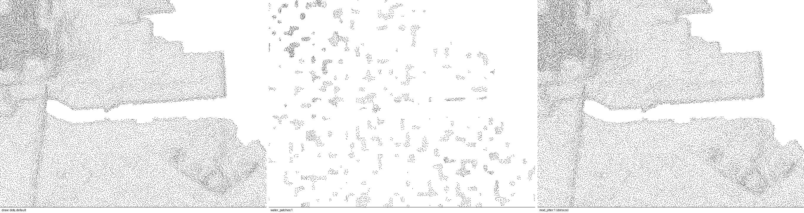

# Land — dots

Stippling instead of lines: `burin.batch({ draw: "dots", style })`. Dots sit
as close as lines would — the same spacing field — and nothing is drawn where
the tone is below `dash_cutoff`.

```js
burin.batch({ angle: 0, draw: "dots", style: { water_patches: 0.6 } });
```

## Parameters

Dots use the land spacing group (`space_*`, `space_steep*`, `input_height`)
to decide density, plus:

| Group | Parameter | Default | What it does |
|---|---|---|---|
| Dash | `dash_cutoff` | 0 | no dots where the tone is below this |
| Mod | `mod_jitter` | 0 | how much dot size varies |
| | `mod_wobble` | 20 | bends the field dots are placed on, on flat ground |
| Water | `water_size` | 1.2 (land default) | each dot's length, px |
| | `water_patches` | 0 | 0 evenly everywhere, 1 gathered in a few patches |

All of [land-lines.md](land-lines.md)'s `space_*`, `input_*` and `sun_*`
parameters still shape the underlying field; `dash_light` / `dash_dark` /
`dash_period` do not apply (there is no dash to break into a period, just a
point per spacing cell).

## Comparison



Left to right: default, `water_patches: 1` (gathered, open ground between),
`mod_jitter: 1` (more size variation per dot).
