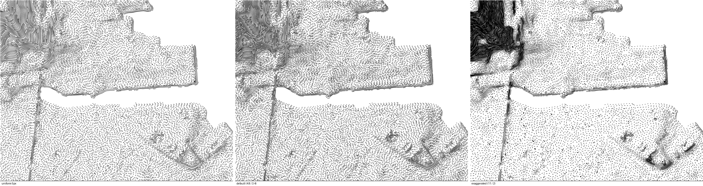
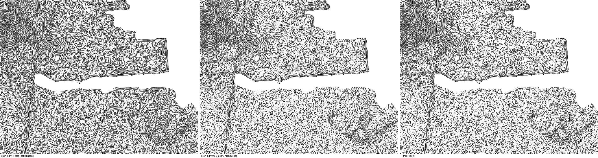
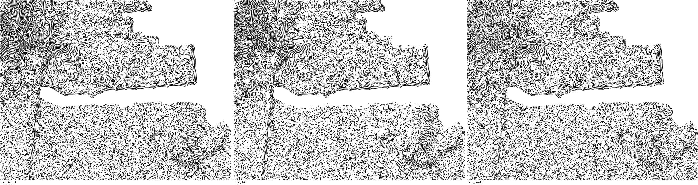
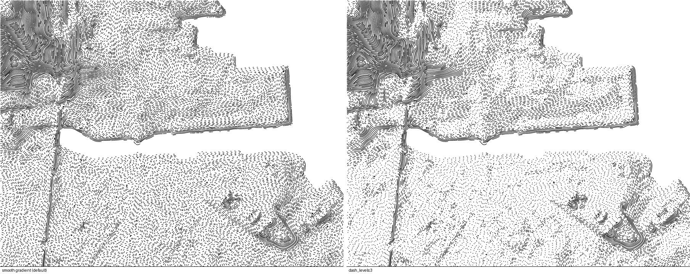

# Land — lines

The default draw style: streamlines traced over the terrain, dashed by light
and shadow. `burin.batch({ angle, style })`, or just `burin.batch({})` for the
engine defaults.

```js
burin.batch({ angle: 0, style: { dash_light: 0.5, dash_dark: 1 } });
```

## Parameters

| Group | Parameter | Default | Terrain† |
|---|---|---|---|
| Space | `space_light` | 4.8 | yes |
| | `space_dark` | 3.4 | yes |
| | `space_steep` | 0.4 | yes |
| | `space_steep_gamma` | 1 | yes |
| Dash | `dash_light` | 0.15 | |
| | `dash_dark` | 1 | |
| | `dash_mid` | -1 | |
| | `dash_period` | 10.5 | |
| | `dash_levels` | 0 | |
| | `dash_cutoff` | 0 | |
| | `dash_solid` | 1 | |
| Mod | `mod_jitter` | 0 | |
| | `mod_flat` | 0 | |
| | `mod_breaks` | 0 | |
| | `mod_wobble` | 20 | yes |
| | `mod_wobble_size` | 12 | yes |
| | `mod_wave` | 0 | |
| | `mod_wave_size` | 16 | |
| | `mod_wave_zone` | 0 | |
| | `mod_wave_even` | 0 | |
| | `mod_smooth` | 6 | yes |
| Input | `input_flat` | 0.25 | yes |
| | `input_gain` | 3 | yes |
| | `input_dark_gamma` | 0.7 | yes |
| | `input_light_gain` | 1.5 | yes |
| | `input_light_floor` | 0.06 | yes |
| | `input_blur` | 1.8 | yes |
| | `input_broad_blur` | 11.5 | yes |
| | `input_broad` | 0.5 | yes |
| | `input_height` | 0 | |
| Sun | `sun_azimuth` | 315 | yes |
| | `sun_altitude` | 45 | yes |
| | `sun_exag` | 4 | yes |
| Engine | `engine_step` | 1 | |
| | `engine_min` | 4 | |
| | `engine_stop` | 0.5 | |
| | `engine_fill` | 0.8 | |
| | `engine_stripes` | 0 | |
| Batch | `batch_floor` | 0 | |
| | `batch_stroke` | 1.2 | |
| | `batch_seed` | 1 | |

† **Terrain** parameters carry over from one batch to the next in a document
(see [SYNTAX.md](../../SYNTAX.md#terrain-carries-over)); the rest fall back to
their default on every batch.

## Spacing: `space_light` / `space_dark`



Left to right: no variation (`space_light` = `space_dark` = 5), the default
(wider in light, tighter in shadow), and an exaggerated gap for teaching.

## Ink: duty and jitter



Left to right: `dash_light: 1, dash_dark: 1` (always solid), `dash_light: 0.5`
(mechanical 50% dashes in light), and the same with `mod_jitter: 1` (same
average ink, hand-drawn look).

## Modifiers: `mod_flat`, `mod_breaks`



Left to right: modifiers off, `mod_flat: 1` (lottery on flat/lit ground),
`mod_breaks: 1` (random breaks in otherwise solid dashes).

## Quantized ink: `dash_levels`



Left: the default smooth gradient. Right: `dash_levels: 3` — tone rounded to
three flat zones (10% / 50% / solid) before duty is computed.

## Ink presets

`presets/ink-*.js` isolate each behaviour above on the same area as Contours.
See the previews on the [Docs](/docs) ink-presets page, or run e.g.:

```bash
burin-map --script presets/ink-levels.js --out-file out.png
```
