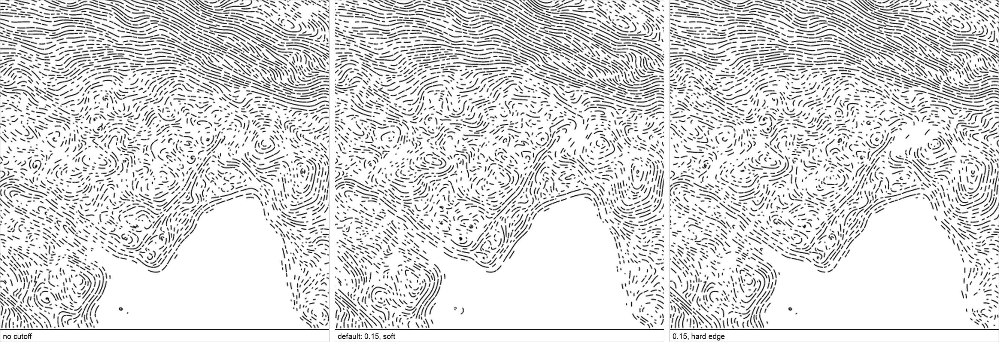
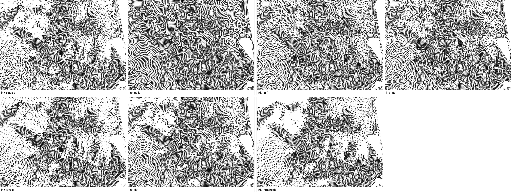

# Land — lines

The default draw style: streamlines traced over the terrain, dashed by light
and shadow. `burin.batch({ angle, style })`, or just `burin.batch({})` for the
engine defaults: uneven dashes (`mod_jitter: 1`), lit flats that break up
(`mod_flat: 0.5`), and lit ground that thins out (`dash_cutoff: 0.15`).
[`presets/contours.js`](../../presets/contours.js) writes every one of them out.

```js
burin.batch({ angle: 0, style: { dash_light: 0.5, dash_dark: 1 } });
```

## Parameters

| Group | Parameter | Default | Carries over |
|---|---|---|---|
| Space | `space_light` | 6 | ✓ |
| | `space_dark` | 7 | ✓ |
| | `space_steep` | 0.4 | ✓ |
| | `space_steep_gamma` | 1 | ✓ |
| Dash | `dash_light` | 0.3 | |
| | `dash_dark` | 0.8 | |
| | `dash_mid` | -1 | |
| | `dash_period` | 10.5 | |
| | `dash_levels` | 0 | |
| | `dash_cutoff` | 0.15 | |
| | `dash_cutoff_soft` | 1 | |
| | `dash_solid` | 1 | |
| Mod | `mod_jitter` | 1 | |
| | `mod_flat` | 0.5 | |
| | `mod_breaks` | 0 | |
| | `mod_wobble` | 20 | ✓ |
| | `mod_wobble_size` | 12 | ✓ |
| | `mod_wave` | 0 | |
| | `mod_wave_size` | 16 | |
| | `mod_wave_zone` | 0 | |
| | `mod_wave_even` | 0 | |
| | `mod_smooth` | 6 | ✓ |
| Input | `input_flat` | 0.25 | ✓ |
| | `input_gain` | 3 | ✓ |
| | `input_dark_gamma` | 0.7 | ✓ |
| | `input_light_gain` | 1.5 | ✓ |
| | `input_light_floor` | 0.06 | ✓ |
| | `input_blur` | 1.8 | ✓ |
| | `input_broad_blur` | 11.5 | ✓ |
| | `input_broad` | 0.5 | ✓ |
| | `input_height` | 0 | |
| Sun | `sun_azimuth` | 315 | ✓ |
| | `sun_altitude` | 45 | ✓ |
| | `sun_exag` | 4 | ✓ |
| Engine | `engine_step` | 1 | |
| | `engine_min` | 4 | |
| | `engine_stop` | 0.5 | |
| | `engine_fill` | 0.8 | |
| | `engine_stripes` | 0 | |
| Batch | `batch_floor` | 0 | |
| | `batch_stroke` | 1.2 | |
| | `batch_seed` | 1 | |

**Carries over (✓):** in a document with several batches, a batch that leaves one of these out
takes it from the batch above, so a second pass (say a 45° crosshatch) follows the same light and
spacing as the first without repeating them. Every other parameter left out goes back to its
default. Details: [SYNTAX.md](../../SYNTAX.md#carries-over).

## Spacing: `space_light` / `space_dark`


Left to right: no variation (`space_light` = `space_dark` = 5), the default
(nearly even, a little wider in shadow, where the longer dashes carry the
dark), and an exaggerated gap for teaching (wide in light, tight in shadow).

## Ink: duty and jitter


Left to right: `dash_light: 1, dash_dark: 1` (always solid), `dash_light: 0.5`
(mechanical 50% dashes in light), and the same with `mod_jitter: 1` (same
average ink, hand-drawn look). The modifiers and the cutoff are off in all
three, so only the duty changes.

## Modifiers: `mod_flat`, `mod_breaks`


Left to right: modifiers off, `mod_flat: 1` (lottery on flat/lit ground),
`mod_breaks: 1` (random breaks in otherwise solid dashes).

## Thinning lit ground: `dash_cutoff`



`dash_cutoff` takes the ink off the lightest part of the tone scale, the same
everywhere: 0.15 is the lightest 15%. `dash_cutoff_soft` says how sharp that
edge is. At 0 it is hard: nothing below the cutoff, all of it above. At 1 the
ink fades in from tone 0 up to the cutoff (a dash survives with a chance of
(tone / cutoff)², so half the cutoff keeps a quarter of the dashes). In between,
the fade starts closer to the cutoff: at 0.5 there is nothing below half of it.
Left to right: no cutoff, the default (0.15, soft), and 0.15 with a hard edge.

A hard edge jumps where much of the ground shares one tone: lit slopes all sit on
`input_light_floor` (0.06), so a hard cutoff empties them all between 0.06 and
0.07. A soft one moves through them gradually.

The other end of the scale is `dash_solid`: above that tone every line is
solid, whatever the dash settings (1, the default, turns it off).

## Quantized ink: `dash_levels`


Left: a smooth gradient. Right: `dash_levels: 3` — tone rounded to three flat
zones (10% / 50% / solid) before duty is computed. Modifiers off in both.

## Ink presets

`presets/ink-*.js` isolate each behaviour above, all on the same area as
Contours. Each writes out a full plain style (even ink, modifiers off) and
changes only what it shows. Below, the same few hills from each:



Run any of them, e.g.:

```bash
burin-map --script presets/ink-levels.js --out-file out.png
```
