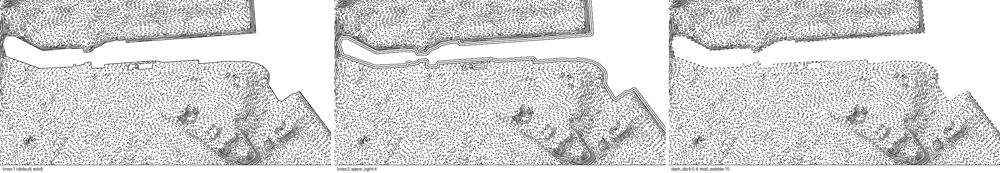

# Shoreline

The coast line itself, drawn with the land's modifiers (`mod_wobble` makes it
wander, `mod_smooth` rounds the pixel steps). With `lines` above 1, more
lines follow it out to sea, `space_light` px apart, fading over `water_reach`
as a water batch's ink does. `burin.shore({ lines, style })`.

```js
burin.shore({ lines: 2, style: { space_light: 4 } });
```

## Parameters

Only the ones that mean something on a line that is already drawn:

| Group | Parameter | Default | What it does |
|---|---|---|---|
| Space | `space_light` | 3 | gap between lines, when `lines` is above 1 |
| Dash | `dash_dark` | 1 | ink on the line at the shore (1 is solid) |
| | `dash_light` | 1 | ink on the lines further out (1 is solid) |
| | `dash_period` | 10.5 | length of one dash plus gap, px |
| | `dash_cutoff` | 0 | below this tone a dash disappears |
| Mod | `mod_jitter` | 0 | random variation in dash length, same average ink |
| | `mod_breaks` | 0 | chance of a small break in the line |
| | `mod_wobble` | 0 | hand-drawn wander, degrees |
| | `mod_wobble_size` | 12 | length of each wander, px |
| | `mod_wave` | 0 | hand-drawn wave, px |

Other fields on the block itself: `layer`, `color`, `color_expr`, `width_expr`,
`width_steps`, `cap` — as on a land batch; the layer is `shoreline` unless set.

## Comparison



Left to right: `lines: 1` (default, solid), `lines: 3, space_light: 4` (a
clean triple line), `dash_dark: 0.4, mod_wobble: 15` (dashed, hand-drawn).
