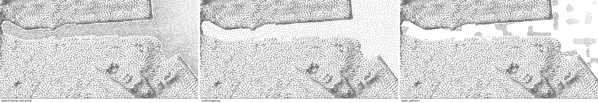

# Water — dots

Stippled water, denser towards the coast, as on Ortelius' maps.
`burin.water("dots", { follow, angle, style })`.

```js
burin.water("dots", { follow: "shore", angle: 0, style: {} });
```

## Parameters

| Group | Parameter | Default | What it does |
|---|---|---|---|
| Space | `space_dark` | 2.25 | distance between dots at `water_start`, px |
| | `space_light` | 6.5 | distance between dots from `water_reach` further out, px |
| Mod | `mod_jitter` | 0 | how much dot size varies |
| Batch | `batch_stroke` | 1.2 | line width |
| | `batch_seed` | 1 | random seed |
| Water | `water_start` | 3 | no dots nearer the shore than this, px |
| | `water_reach` | 250 | distance over which spacing eases `space_dark` → `space_light`, px |
| | `water_fade` | 1 | how it eases |
| | `water_size` | 1.2 | length of each dot, px |
| | `water_patches` | 0 | how much dots gather in patches |

## Comparison



Left to right: default (dense near the shore), uniform spacing everywhere,
`water_patches: 1`.
