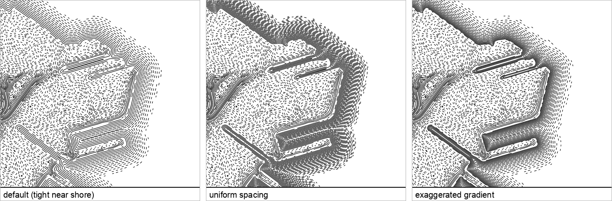

# Water — lines

Lines on water, traced the same way as on land but fed from distance to the
shore instead of terrain shading. `burin.water("lines", { follow, angle, style })`.

```js
burin.water("lines", { follow: "shore", angle: 0, style: { water_reach: 60 } });
```

`follow: "shore"` with `angle: 0` draws true concentric distance contours
(not the streamline tracer), so spacing never crosses the rings. `follow:
"map"` traces one direction over the whole area, like open-sea hatching.

## Parameters

| Group | Parameter | Default | Notes |
|---|---|---|---|
| Space | `space_light` | 7.2 | spacing far from the shore, px (wider rings) |
| | `space_dark` | 3.2 | spacing near the shore, px (tighter rings) |
| Dash | `dash_light` | 0.25 | ink far from the shore |
| | `dash_dark` | 1 | ink near the shore |
| | `dash_mid`, `dash_period`, `dash_levels`, `dash_cutoff`, `dash_solid` | as on land | same ink model, same tone meaning (near = dark) |
| Mod | `mod_jitter` | 0 | |
| | `mod_flat` | 0.6 | leaves out dashes below `input_flat`'s tone |
| | `mod_breaks` | 0 | |
| | `mod_wobble` | 0 | |
| | `mod_smooth` | 3 | |
| Input | `input_flat` | 0.25 | the tone `mod_flat` compares against |
| Engine | `engine_step`, `engine_min`, `engine_stop`, `engine_fill` | as on land | |
| Batch | `batch_stroke`, `batch_seed` | as on land | |
| Water | `water_start` | 2 | gap between the shore and the first line, px |
| | `water_reach` | 60 | how far out ink/tracing stay active, px; not spacing |
| | `water_space_reach` | 120 | how far out spacing eases `space_dark` → `space_light`, px; 0 = fixed `space_light` |
| | `water_fade` | 1 | how the ink eases: above 1 sooner, below 1 later |
| | `water_fray` | 0 | breaks lines into dashes/dots near `water_start`, with a ragged edge |

Left out, as they mean nothing on water: `space_steep*`, `batch_floor`,
`sun_*`, the rest of `input_*`.

## Comparison



Left to right: default (tight near the shore, opening out), uniform spacing
everywhere, and an exaggerated near/far gradient.

## Currents

`follow: "map"` with a strong `mod_wobble` turns lines into swirling currents;
`mod_wave` with `mod_wave_zone: 1` makes neighbours wave together. Set
`water_start` past where the coast batch's `water_start + water_reach` ends,
so currents stay clear of the shore rings. See `examples/ocean-currents.json5`.

## Two water passes: the engraved sea

The best showcase of water lines is [`presets/engraved-sea.js`](../../presets/engraved-sea.js):
one `follow: "shore"` pass from 3 to 20 px off the coast, then a `follow: "map"`
pass from 26 px out over the whole sea, with `mod_wave_even: 1` so every
current waves in step with its neighbours, like an engraved plate. The web docs
(`/docs/examples`) show it whole and zoomable, with each pass explained.
