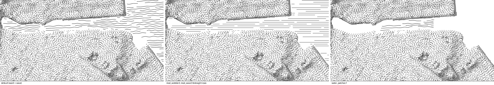

# Water — ripples

Rows of strokes, staggered and broken, bending together with a swell and
waving by hand — the sea of Olaus Magnus' *Carta Marina*.
`burin.water("ripples", { follow, angle, style })`.

```js
burin.water("ripples", { follow: "map", angle: 90, style: {} });
```

`follow: "map"` with `angle: 90` keeps rows level; `follow: "shore"` runs them
along the coast. `water_patches` gathers rows into patches, leaving open sea
between.

## Parameters

| Group | Parameter | Default | What it does |
|---|---|---|---|
| Space | `space_light` | 9 | gap between rows, px |
| Dash | `dash_dark` | 0.9 | how much of a row is inked at `water_start` |
| | `dash_light` | 0.6 | how much is inked from `water_reach` further out |
| Mod | `mod_wobble` | 18 | how much the swell bends the rows, degrees |
| | `mod_wobble_size` | 150 | length of each swell, px |
| | `mod_wave` | 1.5 | hand-drawn wave on each stroke, px |
| | `mod_wave_size` | 40 | length of each wave, px |
| | `mod_wave_zone` | 0 | how much neighbouring rows wave together |
| | `mod_smooth` | 3 | rounds off rows along the coast (`follow: "shore"`) |
| Batch | `batch_stroke` | 1.2 | line width |
| | `batch_seed` | 1 | random seed |
| Water | `water_start` | 4 | no ripples nearer the shore than this, px |
| | `water_reach` | 300 | distance over which ink eases `dash_dark` → `dash_light`, px |
| | `water_fade` | 1 | how it eases |
| | `water_size` | 140 | length of each stroke, px |
| | `water_patches` | 0 | 0 evenly everywhere, 1 a few patches |

## Comparison



Left to right: default (swell + wave), `mod_wobble: 0, mod_wave: 0` (straight,
mechanical rows), `water_patches: 1` (gathered, open sea between).
